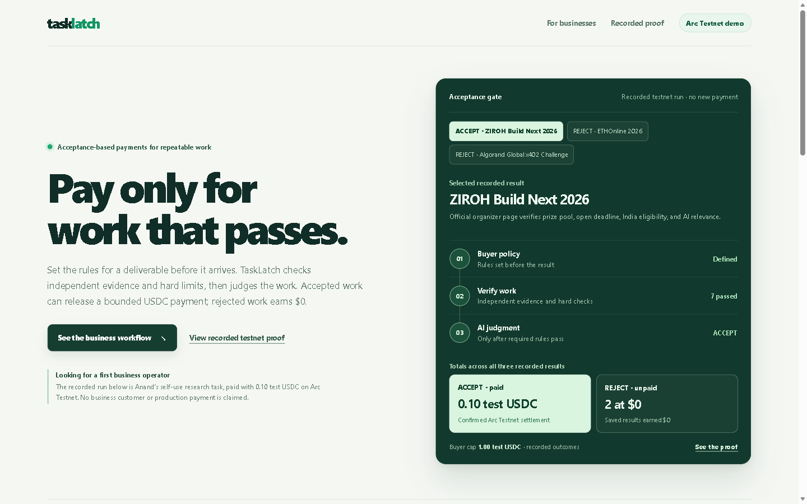

# TaskLatch — Pay only for work that passes

TaskLatch is a local working name for an acceptance-gated payment prototype. The current app demonstrates one fixed operator task; it does not let buyers create arbitrary jobs or policies. For that saved run, the agent checks independent evidence, hard rules constrain AI judgment, and the existing Arc Testnet escrow settles only an accepted result.

Code and project-authored documentation in this directory are MIT licensed; see [LICENSE](LICENSE). External sources retain their owners' rights. The npm package is marked `private` to prevent accidental registry publication.

The prior prototype and deployed contract are named ProofPay. We adopted TaskLatch locally after finding a public autonomous procurement project named ProofPay with a closely related agent, evidence, policy-gate, and escrow flow. Historical contract, environment, and run identifiers keep their original names. TaskLatch is a working label; no trademark or domain clearance has been performed.

## 60-second proof

- One real self-use operator task; three candidate results evaluated.
- One ACCEPT and two REJECT decisions, each with evidence and a persisted receipt.
- Exactly 0.10 test USDC paid for the accepted ZIROH opportunity on Arc Testnet.
- To inspect the UI, follow [Run locally](#run-locally); there is no public deployment yet. [Inspect the verified Arc Testnet transaction](https://explorer.testnet.arc.io/tx/0xc43b20352f0c118efbaaa975bb10abe0b07b0ef8634f1bbe9d77ea4f49d24a7d).

This is Anand's personal self-use run, not business traction. The task asks for ten opportunities, but only three candidates were processed in ProofPay. The remaining research shortlist is not product output. The Tameion FAQ allows a builder's own company to serve as operator, but the current personal research task is not a business-money workflow; no qualifying business use is demonstrated yet.

## Current interface capture



Also available: [accepted settlement and separate manual deadline recheck](docs/settlement-current.png) and [expanded decision receipt](docs/receipt-current.png), both captured 5 October. They show the same saved self-use payout, but predate the latest page layout. These screenshots do not replace the required under-three-minute recorded demo.

The business explanation now includes the user-supplied **Proof Gate** artwork: a 165 KB WebP poster and an optional 1.13 MB GLB viewer. It is labeled as an illustration and never supplies acceptance, payment, or receipt facts. The `View 3D` control loads pinned Three.js r180 only on request; if WebGL, the dependency, or the model is unavailable, the poster remains. The saved decision selector can highlight an illustrative route after 3D loads, while the app's persisted result and receipt remain authoritative. The editable Blender source stays in the owner's original ZIP outside this project; confirm its redistribution terms before public release.

## Tameion fit and remaining proof

The closest fit is RFB 3, Contractor & Vendor Network Manager. The current prototype proves a fixed per-result acceptance and testnet settlement path; it does not manage a vendor network, maintain contractor performance history, or demonstrate a genuine business workflow. The official Tameion page points builders to [`circlefin/arc-escrow`](https://github.com/circlefin/arc-escrow) for AI-validated deliverables and release/refund; that sample already uses Circle Developer-Controlled Wallets and AI work validation. TaskLatch's code adds independently fetched, hashed source evidence and deterministic pre-AI eligibility gates. Those are implementation differences, not proven business differentiation, until an operator confirms they solve a real need.

**Circle/Arc integration status:** the verified run uses Arc Testnet, Circle test USDC, and the existing escrow contract, signed by a locally held EOA. It does not use a Circle Agent Wallet, Gateway/x402, Paymaster, App Kit, CCTP, or Developer-Controlled Wallet. Circle's [transaction-signing guide](https://developers.circle.com/wallets/sign-transactions) now documents an `arcTestnet` Developer-Controlled Wallet signing flow, and Canteen's [`arc-escrow` reference](https://github.com/circlefin/arc-escrow) uses Developer-Controlled Wallets on Arc Testnet. Arc Testnet signing is technically feasible, but the existing funded job binds its agent address when opened; a different Circle wallet would need a separately funded job. No Circle-managed signer has been integrated or used in this project. We claim only the Arc/USDC/contract path shown by the saved transaction.

### Tameion event delta

The capped escrow prototype existed before the 27 September, 5:30 PM IST kickoff. In the saved opportunity run, official-source fetches and Groq decisions are timestamped 11:59 AM–12:09 PM IST that day, so those evaluations are pre-event baseline—not product or traction gained during Tameion. The later `verifiedAt` field records a local receipt check, not the transaction's block time.

Post-kickoff code work includes a standalone signed-policy prototype that is not wired into the recorded payout, a guard requiring the unique Canteen RPC endpoint before Arc operations, and official deadline parsing that fails closed on expired, missing, or conflicting dates. These are correctness and integration-preparation changes; they do not establish Circle Agent Stack usage, a business workflow, or adoption. Businesses onboarded: **0**. See the [operator-run evidence note](docs/operator-run.md) for the dated baseline and current evidence limits.

The most important remaining evidence is one real business supplying its own task and acceptance criteria, reviewing genuine outputs, and using the workflow. The saved local video predates the current UI and is not submission-ready. The current official submission deadline is 17 October 2026 at 11:59 PM ET.

## What happens to a result

`signed result → official evidence → deterministic policy → AI judgment → bounded Arc settlement → payability receipt`

The **Policy Firewall** is the boundary between judgment and money: hard checks run before the AI decision. A failed required check forces REJECT and $0; the model cannot override it. Only ACCEPT is eligible for the existing fixed-price settlement path.

The Payability Receipt explains both payment and non-payment. It records the buyer policy, signed submission, official source URLs with retrieval time and page hash, hard-check outcomes, AI judgment when invoked (or an explicit skipped status), amount, provider, Arc transaction when paid, and the separate decision receipt hash. The historical saved rejections include Groq verdicts because that run called the model after hard failures. Future evaluations skip the model on a hard REJECT or ESCALATE; neither path can pay.

## The recorded self-use run

The operator asked for active AI/Web3 hackathons, grants, bounties, or builder programs worth considering, with a verifiable benefit worth at least ₹1 lakh, an open deadline, India eligibility, an official source, and meaningful builder relevance. Ten preliminary opportunities were researched, but only the three candidates below were submitted to this fixed ProofPay workflow.

| Candidate | ProofPay decision | Evidence-based reason | Payment |
|---|---|---|---:|
| [ZIROH Build Next 2026](https://www.ziroh.com/hackathon) | ACCEPT | In the official-page snapshot fetched 27 September: ₹7.5 lakh pool, 15 October deadline, India eligibility, and AI relevance. | 0.10 test USDC |
| [ETHOnline 2026](https://ethglobal.com/events/ethonline2026) | REJECT | Official event dates ended 16 September 2026. | 0 |
| [Algorand Global x402 Challenge](https://algorand.co/global-x402-challenge) | REJECT | [Official rules](https://algorand.co/hubfs/Hackathon%20Terms%20and%20conditions/x402%20competition%20Official%20Rules_Sep3rd26_.pdf) closed new-entrant registration on 1 September; the later submission deadline applies to registered entrants. | 0 |

The Algorand candidate was first escalated using incomplete event information. The official rules clarified the new-entrant cutoff, and the saved result was corrected to REJECT. The current run does not manufacture an ambiguous outcome. See the [operator-run evidence note](docs/operator-run.md).

### Separate ZIROH source recheck — 5 October 2026

The organizer's [current official page](https://www.ziroh.com/hackathon) now says the submission link is open through **16 October 2026**. This differs from the page snapshot ProofPay fetched on 27 September, which said 15 October. The paid ACCEPT and its receipt remain tied to the original snapshot; the recheck is a separately dated manual note, not a new ProofPay evaluation or payment. The local UI labels both dates, and the source update is recorded in [`public/operator-run-source-updates.json`](public/operator-run-source-updates.json). The live evaluator now parses the official deadline from each fetched page and fails closed on missing or conflicting dates.

## Arc Testnet settlement

- Chain ID `5042002`; test USDC `0x3600000000000000000000000000000000000000`.
- Job `proofpay-opportunities-20260927-01`: 10 units at 0.10 test USDC; 1.00 test USDC maximum cap.
- Buyer, provider, and agent are distinct roles. No contract was deployed for this run.
- [Funding transaction](https://explorer.testnet.arc.io/tx/0xb910dbad55ca43a83c71f1b43016bc66ba41e24a643f4dd52c865df126ae200a).
- [Accepted-result settlement](https://explorer.testnet.arc.io/tx/0xc43b20352f0c118efbaaa975bb10abe0b07b0ef8634f1bbe9d77ea4f49d24a7d). Its `ResultResolved` event matches the job, result, 0.10 amount, and decision receipt hash `0xb27fef8cfcf88c3628e1ea0f41f265730419e9c8319fc17f7ef5532ec8fb0398`. The provider balance increased by at least 0.10 test USDC.
- Read-only verification succeeded in a fresh process. The on-chain duplicate guard refused replay; no second payout occurred.

The decision receipt hash and Arc transaction hash prove different things. No Circle/x402 evidence purchase was made because official sources were sufficient for this task.

## Run locally

Requires Node.js `^20.19.0 || >=22.12.0` and npm. This workflow was verified on Node.js 24.14.1.

```sh
npm ci
npm run dev
```

Open `http://127.0.0.1:5173/`. The API binds to `127.0.0.1:8787`. The main page is the recorded operator run; `http://127.0.0.1:5173/fixture.html` is a separate historical policy test. These local URLs work only after starting the app; judges cannot open them from this README.

The saved operator page is static and can be viewed without credentials. Any Arc Testnet RPC operation requires `ARC_RPC_URL` to be set to the unique endpoint supplied by the Canteen ARC CLI. The repository intentionally has no shared public RPC fallback; do not copy a credential-bearing endpoint into source, logs, screenshots, or public documentation.

The browser reads [`public/operator-run.json`](public/operator-run.json), a sanitized view that omits provider signatures and raw fetched page text, plus a separately dated recheck in [`public/operator-run-source-updates.json`](public/operator-run-source-updates.json). The owner's canonical `data/` ledger is deliberately omitted from the standalone public-source export because it contains provider signatures and raw fetched pages. The recheck never mutates the saved decision or payment. The CLI and API use the same [`server/opportunity-service.js`](server/opportunity-service.js). The API accepts only signed submissions matching the three recorded candidate identities and official URLs; it is not a general job-creation service and does not initiate settlement from its result-submission route. See the live [`OpenAPI document`](http://127.0.0.1:8787/api/v1/openapi) while the local server is running.

`server/acceptance-policy.js` is a separate early primitive for canonicalizing a fixed acceptance policy, hashing it, and checking buyer and provider EVM signatures. It is not yet part of the recorded run, API, or settlement decision path. Do not describe the current payment as enforced by this new policy module.

The public-source export contains no private run ledger or signer credentials. Verify the published Arc Testnet payment through the explorer link above. The private operator `evaluate` command is one-shot; do not repeat `fund` or `settle` to create another demo payment. Keep the ignored `.env` and local runtime state out of source, logs, screenshots, and deployment.

## Reliability checks

The focused checks are `npm run test:opportunity`, `npm run test:agentic`, `npm run test:openapi`, `npm run test:policy`, `npm run test:rpc-config`, and `npm run test:contract`; production assets build with `npm run build`. The opportunity service test uses a mocked chain; the contract test uses an isolated local EVM. Neither test submits a transaction to Arc Testnet.

Adversarial regression: a mocked AI ACCEPT cannot override official evidence that new-entrant registration is closed. The deterministic gate rejects that candidate with $0. When evidence about eligibility is missing, the result escalates with $0.

## Scope and release status

The payment contract is frozen. MCP/A2A, mainnet, x402 purchases, new contracts, and generic job creation are out of scope. No genuine business-money workflow has been demonstrated; outreach alone is not traction.

Before another live model call, revoke the previously exposed Groq credential and use a fresh key stored only in the ignored `.env`. A [2:47 narrated technical demo](https://youtu.be/hUB9TVYb8B8) is available on YouTube, with the [MP4 source copy](demo/proofpay-demo-2026-09-27.mp4) in this repository. It was recorded on 27 September and shows the genuine self-use testnet run with an older interface; it is not evidence of business traction or the latest visual design. The current screenshots show the later interface.
